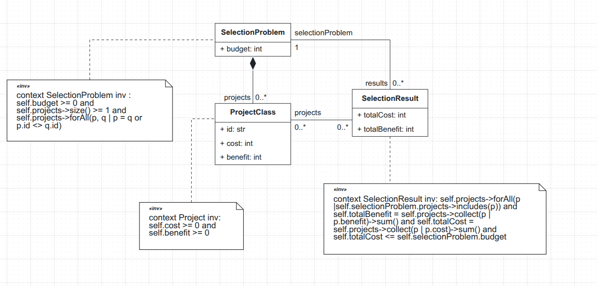
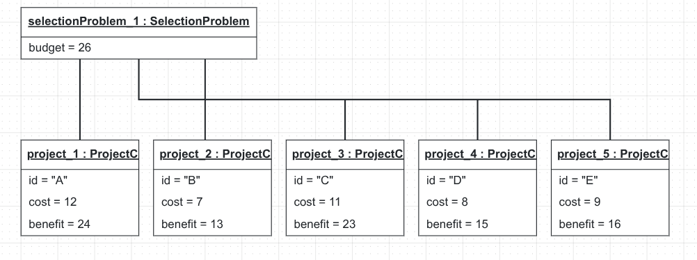
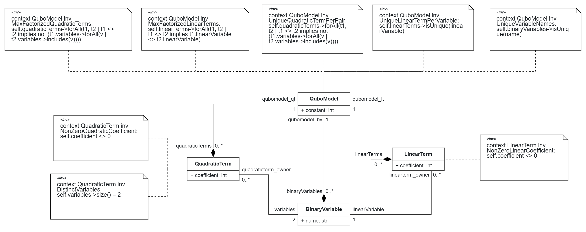
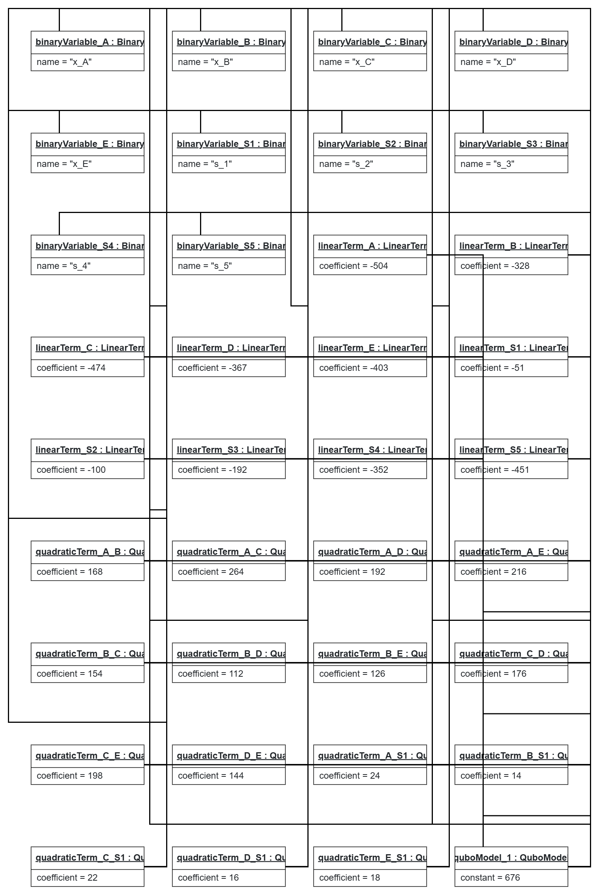

# TACS Project Group 4
Gonçalo Sampaio
Rémi Linossier
Francisco Nunes

## Project Selection Problem (0/1 Knapsack)
The **0/1 Knapsack problem** consists of **selecting a subset of items** out of a given list inside a **knapsack with a fixed maximum weight**, so that the subset **maximizes the total value without exceeding the capacity** of the bag. Each item has a **fixed weight and value**, can only be **selected once** and **cannot be divided into a fraction** (e.g. selecting half an item is not allowed) [[1]](#1).

In the context of **Project Selection**, the 0/1 Knapsack problem can be applied to selecting a subset of projects under a limited budget (the knapsack's maximum capacity), where each project has a cost (weight) and a benefit (value). The goal is to maximize the total benefit of the selection without exceeding the available budget.

## Problem DSL
A **Domain Specific Language** was designed to allow users to model portfolio selection problems by specifying a set of available projects, their costs and benefits and a maximum budget that can be spent in the selection. The DSL was developed using **BESSER** where a UML Class Diagram was created to define its concepts, attributes, constraints and relationships. 

| Concept | Intrinsic Properties | Extrinsic Properties |
|-|-|-|
| SelectionProblem | budget: Integer | Contains at least one project and zero or more SelectionResults |
| Project | id: String; cost: Integer; benefit: Integer | Belongs to one Selection Problem and is a candidate to its solution |
| SelectionResult | totalCost: Integer; totalBenefit: Integer | Belongs to one SelectionProblem and references zero or more Projects |

*Table 1: Problem DSL Concept List*

*Figure 1: Problem DSL Class Diagram*

- **SelectionProblem** represents the project selection problem (0/1 Knapsack) defined by a list of available projects and a budget, grouping all candidate projects and defining the budget that can be spent.
- **Project** represents a candidate project, identified by an unique id and containing a cost and a benefit that represent, respectively, the weight and value of an item in the original problem.
- **SelectionResult** represents a feasible selection of Projects for a specific SelectionProblem and includes its total cost and benefit and was created to separate the problem definition from its possible results, allowing the Problem to exist with 0 or more feasible selections. 

> The Class Diagram was exported to B-UML Python code: [problem_DSL_class_diagram.py](./code/problem_DSL_class_diagram.py)

### Domain Rules
Several domain rules were introduced to ensure the consistency and validity of the problem instances and OCL constraints were used to enforce conditions that cannot be fully expressed through the metamodel's attributes and associations:
- R1: The budget of the problem must be a non-negative integer
- R2: Each project's cost must be a non-negative integer
- R3: Each project's benefit must be a non-negative integer
- R4: In the same SelectionProblem, each Project must have an unique id
- R5: A SelectionProblem must have at least one candidate project
- R6: All Projects referenced by a SelectionResult must belong to the same SelectionProblem the SelectionResult belongs to
- R7: The sum of the benefits of the Projects that belong in a SelectionResult must equal its totalBenefit
- R8: The sum of the costs of the Projects that belong in a SelectionResult must equal its totalCost
- R9: The total cost of a SelectionResult must not exceed the SelectionProblem's budget

### Example Object Model
Three test cases were selected to demonstrate the application of the DSL, as documented in [Test-Cases.md](./docs/Test-Cases.md) [[2](#2), [3](#3), [4](#4)]. The first test case was used to create an Object Diagram in BESSER that represents a problem with five candidate projects and a budget of 26 where each project is represented as an instance of the Project class, associated with a single SelectionProblem instance [[2]](#2):

*Figure 2: Problem DSL Object Diagram for Test Case 1.*

> This Object Diagram was exported to B-UML Python code: [problem_DSL_object_diagram.py](./code/problem_DSL_object_diagram.py)

## Solution DSL Design
A Domain Specific Language was designed to implement the mathematical optimisation equation. It represents a cost function thanks to binary variables, linear and quadratic coefficients. The DSL was developed using **BESSER** where a UML Class Diagram was created to define its concepts, attributes and relationships. 

| Concept | Intrinsic Properties | Extrinsic Properties |
|-|-|-|
| QuboModel | constant: Integer | Contains the BinaryVariables, LinearTerms, QuadraticTerms |
| BinaryVariable | name: String; | Belongs to one QuboModel |
| LinearTerm | coefficient: Integer | Belongs to one BinaryVariable |
| QuadraticTerm | coefficient: Integer | Belongs to two BinaryVariable |

*Table 2: Solution DSL Concept List*

*Figure 3: Solution DSL Class Diagram*

> The Class Diagram was exported to B-UML Python code: [solution_DSL_class_diagram.py](./code/solution_DSL_class_diagram.py)

- **QuboModel** represents a Quadratic Unconstrained Binary Optimization formulation, defined by the value of the constant. It groups all decision variables, linear and quadratic terms which create the cost equation. 
- **BinaryVariable** represents a binary decision variable (0/1). Identified by a name and representing either a project selection variable or a slack variable used to encode constraints (maximum size of the knapsack). 
- **LinearTerm** represents first order terms in the polynomial equation. Defined by an integer coefficient associated with a single BinaryVariable to model the contribution of this specific project to the result. 
- **QuadraticTerm** represents second order terms in the polynomial equation. Defined by an integer coefficient associated with two BinaryVariable to model the constraint of maximum budget.

### Domain Rules
Several domain rules were introduced to ensure the consistency and validity of the solution instances and OCL constraints were used to enforce conditions that cannot be fully expressed through the metamodel's attributes and associations:
- R1: Each BinaryVariables must have a unique name 
- R2: Each LinearTerm must be different than 0
- R3: Each QuadraticTerm must be different than 0
- R4: Each QuadraticTerm must be associated with two different BinaryVariable
- R5: Each BinaryVariable must be associated with an unique LinearTerm
- R6: Each pair of BinaryVariable must be associated with a unique QuadraticTerm
- R7: LinearTerm must be factorized as much as possible 
- R8: QuadraticTerm must be factorized as much as possible

### Example Object Model
The first test case was also used to create the corresponding Solution Object Model, representing the Project Selection problem using the QUBO formulation. The model contains five binary decision variables (x_A to x_E), representing the five candidate projects, and five slack binary variables (s_1 to s_5), used to encode the budget constraint. The QuboModel groups these variables together with the linear and quadratic terms representing the mathematical cost function. The original optimization problem maximizes the total benefit of the selected projects while respecting a budget of 26. The intended QUBO transformation converts benefit maximization into minimization and incorporates the budget constraint through a quadratic penalty function [[5]](#5):

$$
f(x,s)=-\sum_i b_ix_i+\lambda\left(\sum_i c_ix_i+s-26\right)^2
$$

where $b_i$ and $c_i$ represent each project's benefit and cost, respectively, $\lambda$ is the penalty coefficient, and $s=s_1+2s_2+4s_3+8s_4+16s_5$ encodes the unused budget.

*Figure 4: Solution DSL Object Diagram for Test Case 1.*

> The Object Diagram was implemented in B-UML Python code: [solution_DSL_object_diagram.py](./code/solution_DSL_object_diagram.py)

## Problem-to-Solution DSL Mapping
The following table describes how the concepts from the Problem DSL are mapped to the Solution DSL [[5]](#5).

| Problem DSL | Solution DSL | Mapping |
|-|-|-|
| SelectionProblem | QuboModel | represents the optimization problem through a mathematical cost function |
| Project | BinaryVariable | a project corresponds to a binary variable indicating whether it is selected or not (0 or 1) |
| Project.benefit | LinearTerm | contributes to the objective function, with negative coefficients to represent benefit maximization as minimization |
| Project.cost | LinearTerm, QuadraticTerm | contributes to the penalty terms used to encode the budget constraint |
| SelectionProblem.budget | QuboModel | contributes to the coefficients and constant term of the capacity penalty |
| SelectionResult | *No direct equivalent* | represents a feasible project selection in the original domain, rather than an element of the QUBO formulation |

*Table 3: Mapping between the Problem and Solution DSLs concepts.*

## LLM usage log
| Goal | Tool | Validation |
|-|-|-|
| finding real and verified test cases | ChatGPT | Compared the test cases against the original benchmark sources and checked the optimal solutions |
| evaluating the inclusion of *SelectionResult* in Problem DSL | ChatGPT | Reviewed the decision against the domain requirements and the metamodel structure |
| corrections in OCL syntax | gemini & ChatGPT | Quality Check of the class diagram in Besser |
| creating the solution object code based on the solution class code. Create the object by hand in the GUI of Besser would have been difficult because of the high number of links between objects | gemini | manually stepped through the code to look at the object instances and links + Quality Check of the object diagram in Besser |
| creating the mathematical formulation of the solution because we haven't found a test case with | gemini | Quality Check of the object diagram in Besser |
| improving grammar and writing and verifying spelling | ChatGPT | Manually reviewed suggested corrections to ensure that the content, terminology, and intended meaning remained unchanged |

## References
<a id="1">[1]</a> H. Kellerer, U. Pferschy, and D. Pisinger, Knapsack Problems. Springer, 2004. https://doi.org/10.1007/978-3-540-24777-7
<a id="2">[2]</a> J. Burkardt, KNAPSACK_01 — Data for the 01 Knapsack Problem, datasets P02 and P04. https://people.sc.fsu.edu/~jburkardt/datasets/knapsack_01/knapsack_01.html
<a id="3">[3]</a> K. Lian, Hands-on Optimization with OR-Tools in Python, Chapter 8: The Knapsack Problem, 2023. https://kunlei.github.io/python-ortools-notes/ip-knapsack.html
<a id="4">[4]</a> Lolik-Bolik, Knapsack_problem_0-1, GitHub repository. https://github.com/Lolik-Bolik/Knapsack_problem_0-1
<a id="5">[5]</a> CodingThrust, [Rule] Knapsack to QUBO, problem-reductions, GitHub Issue #116, 2026. https://github.com/CodingThrust/problem-reductions/issues/116